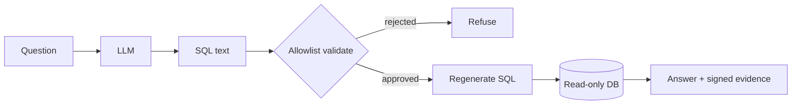

# Ask a database without running model SQL as written

## The problem

The usual "chat with your data" path is: dump the schema, have an LLM write SQL, run it.
That works in demos and fails in production.

1. **It can be wrong and sound right.** A bad query still returns a number.
2. **It can be talked into anything.** The model's output is a string you execute.

This project never executes the model's SQL text.

## The idea

The LLM proposes SQL. Code you own parses it, checks **every expression** against a
human-approved **catalog**, and **regenerates** the SQL that runs. Shapes that could
smuggle columns past the check (COLUMNS, `#n`, STRUCT(*), whole-row references, time
travel) are refused.

The LLM box is untrusted. Everything after it is testable code.

## Catalog vs database vs Unity Catalog

| | Who decides | Role |
|---|---|---|
| Database schema | The warehouse | Fact: what exists |
| **Secure Query catalog** | A human | Allowlist the planner may name |
| Databricks **Unity Catalog** | Warehouse admins | Grants, RLS, masks at execute time |

A live schema dump is the wrong allowlist: it includes internal, deprecated and sensitive
columns. `fetch_unity_catalog_draft` / `catalog_draft` produce an **unapproved draft**. PII
flags and join keys need review before the file is used as `SECURE_QUERY_CATALOG_FILE`.

The demo catalog is all 11 [Chinook](https://github.com/lerocha/chinook-database) tables.
`Email` is `pii_risk=high`; `Invoice.Total` is `unit=USD`.

## One question, end to end

`python -m secure_query.demo.ask "What are the top 3 billing countries by total revenue?"`

1. **Plan:** the model returns `{"sql": "..."}` or declines. One repair is allowed, using
   the validator's error messages.
2. **Validate:** tables, columns, approved joins, PII, row filters, fan-out, LIMIT.
3. **Ground values:** string literals are checked against stored values through the same
   validator and read-only executor. Stored values are never sent to the model.
4. **Show the evidence:** if the query ranks or filters groups by a number it does not
   return (`ORDER BY COUNT(*) DESC LIMIT 3`), that number is added to the answer.
5. **Check consistency:** the question is planned a second time; if the two readings give
   different answers, the system refuses instead of guessing.
6. **Confirm, then run:** the UI shows the regenerated SQL. **Run** executes exactly the
   reviewed query, signed for this user.
7. **Record:** a trace record and a signed Evidence Bundle (hashes, not question text).

## Honest limits

- A valid query can still answer a different business question. Read the SQL before Run.
- Catalog review is manual. Retrieval shrinks the prompt; validation still uses the full
  authorized catalog.
- Result cells are never sent to an LLM ([ADR 001](adr/001-result-policy.md)).
- Production on your warehouse needs an approved catalog, a named owner and an adjudicated
  domain holdout ([STATUS.md](STATUS.md)).

## Try it

Follow the root [README](../README.md), then use the CLI or http://localhost:8000/.
